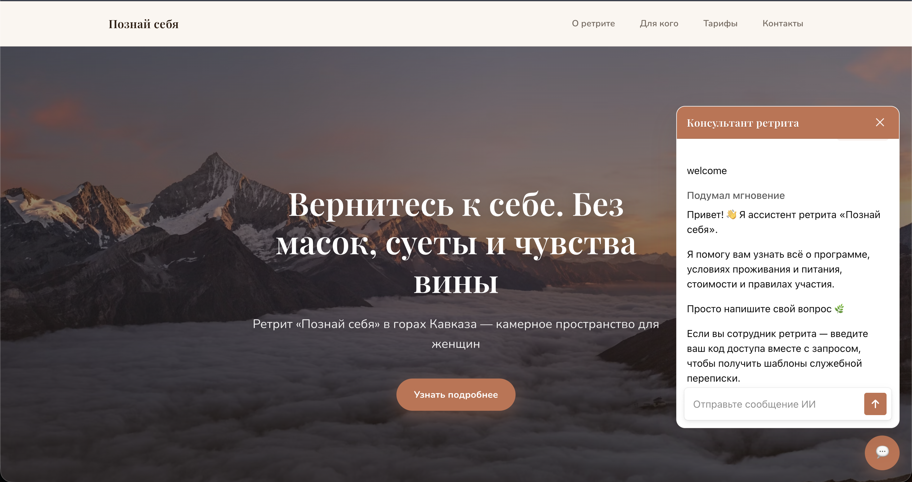
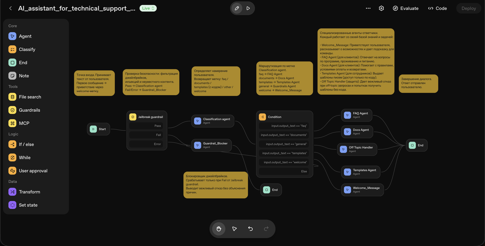

# Multi-agent chat widget: one assistant for guests and the team

A chat widget on a women's retreat landing page. It answers visitors' questions about the program and terms, and gives the team templates for service emails. Demo: [retreat.tatidzufri.com](https://retreat.tatidzufri.com).

This is a practice project. The retreat, "Know Yourself" («Познай себя»), is a training scenario of a retreat center, not a real organization. Case study: [tatidzufri.com/en/case/ai-support-assistant](https://tatidzufri.com/en/case/ai-support-assistant).



## About the project

A visitor clicks the chat icon in the corner, types a question in plain words and gets an answer right away. Inside is a chain of agents on the OpenAI Agents SDK: each owns its topic, and a classifier decides who gets the question. The assistant speaks Russian and English; the page sets the language (`/` or `/en/`).

Until November 2026 the agents lived in OpenAI Agent Builder. OpenAI is shutting it down on 30.11.2026, so the workflow was moved into code on my own ChatKit server. How the move went and what had to be fixed in the export is in [MIGRATION.md](MIGRATION.md).

The same widget serves two audiences. Guests get answers about the retreat; staff reach the templates agent with a code word. Internal information is never shown to guests.

## The task

A retreat organizer answers the same questions over and over: program, accommodation, meals, price, participation and refund rules. Staff need email templates and ask for them by hand too. Two separate bots for guests and the team are harder to maintain and cost more.

The goal was one assistant that answers guests in the brand's caring tone, gives templates only to the team and doesn't fall for attempts to pull internal content out with a clever prompt.

## How it works

1. **Protection first.** The Jailbreak guardrail (openai-guardrails) cuts off manipulation attempts and prompt injections. It runs in parallel with the classifier, so it doesn't slow the answer.
2. **Topic classifier.** The classifier agent returns exactly one of five topics: greeting, FAQ, documents, templates, off-topic.
3. **Agents.** FAQ Agent answers about the program, accommodation and preparation. Docs Agent explains rules, payment and refunds. Templates Agent gives staff the correspondence templates. Off Topic Handler politely declines off-topic questions. The greeting and the guardrail refusal are fixed texts with no model call.
4. **Knowledge base first.** Each agent has its own knowledge base (vector store), one per language, and must search it before answering.
5. **A code word for the team.** Without it no templates are given out: the check is in code, not only in the model's instruction.
6. **My own ChatKit server.** A FastAPI server on the openai-chatkit package streams the agent's answer into the widget. Conversations are stored in SQLite and the agent remembers the latest messages in the thread. Each visitor sees only their own conversations. There are daily demo limits and a message length limit.

## What it looks like

**The widget on the landing page.** A floating chat window with the assistant's greeting (screenshot at the top).

**The original workflow in Agent Builder** (before the move to code): entry point, guard node, classifier and agents.



## Results

- One assistant for two audiences: guests and the team.
- Internal templates are isolated from guests, available only with the code word.
- Answers around the clock, with protection against prompt injections.
- The move from Agent Builder to code took one day; I checked it on 14 test scenarios.

## Tech stack

| Technology | What it's for |
|---|---|
| **OpenAI Agents SDK** | Agents, the classifier, knowledge base search (`openai-agents`) |
| **OpenAI ChatKit** | The chat widget in the browser and the ChatKit protocol server in Python (`openai-chatkit`) |
| **openai-guardrails** | Jailbreak and prompt-injection checks |
| **OpenAI API** | gpt-4.1-mini models and vector stores with RU and EN knowledge bases |
| **FastAPI + Uvicorn** | Backend: the `/api/chatkit` endpoint, the visitor cookie, CORS |
| **SQLite** | Conversations and daily demo limits |
| **python-dotenv** | The API key and knowledge base ids in `.env`, outside the code |
| **Docker** | Runs the backend on the server behind nginx |
| **HTML, CSS, JavaScript** | The retreat landing page and the floating widget, no framework |

## Repository structure

- `retreat-case/index.html`: the retreat landing page.
- `retreat-case/assets/js/widget.js`: the chat widget. Locally it calls `http://127.0.0.1:8000/api/chatkit`, on the site `/api/chatkit`. It takes the language from `<html lang>`.
- `retreat-case/server/retreat_agents.py`: agents and their RU and EN instructions.
- `retreat-case/server/chatkit_server.py`: the ChatKit server: guardrail, classifier, agents, limits.
- `retreat-case/server/sqlite_store.py`: conversation storage.
- `agent-builder-en/`: the English knowledge bases.
- `MIGRATION.md`: the move off Agent Builder.
- `retreat-case/assets/css/`: landing page styles.
- `retreat-case/server/`: the Dockerfile and `main.py` (FastAPI).
- `retreat-case/demo/`: screenshots.

## Running it

You need Python 3.11+, an OpenAI API key and vector stores with the knowledge bases (files `01–03` in the case root for RU and in `agent-builder-en/` for EN).

```bash
cd retreat-case/server
python -m venv .venv && source .venv/bin/activate
pip install -r requirements.txt
cp .env.example .env          # OPENAI_API_KEY, VS_*_RU, VS_*_EN, STAFF_CODE
uvicorn main:app --port 8000
```

Open the landing page through a local server from `retreat-case`, for example `python -m http.server 5500`, and go to `http://localhost:5500`. The widget finds the backend on port 8000 by itself.

## Author

Tetiana Dziubas, AI automation engineer. I build Telegram bots, RAG assistants and LLM agents that take routine work off small teams. Case studies and contact: [tatidzufri.com/en](https://tatidzufri.com/en/).
